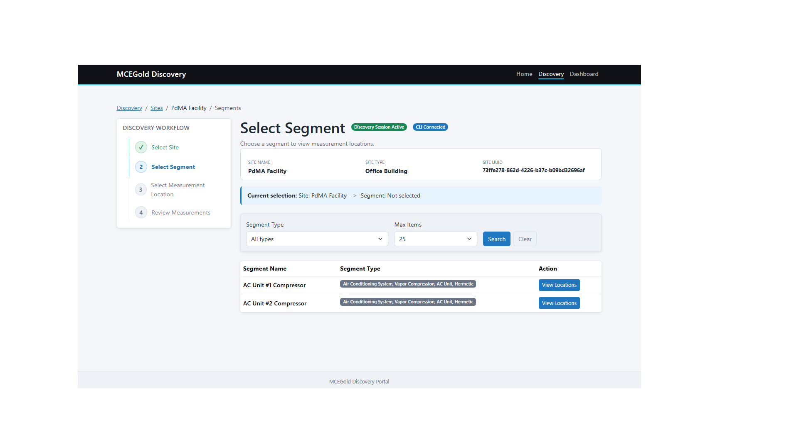

# MCEGold Discovery Portal

MCEGold Discovery Portal is a deployable reference appliance for exploring MCEGold Data Services discovery workflows, collecting published measurement data, and viewing locally persisted results in Grafana.

## Purpose

This project provides a practical way to explore and validate MCEGold Data Services without first building a custom integration. It helps users discover the MCEGold hierarchy and measurements, understand how MCEGold Data Services can be integrated, collect published measurement data, persist discovered data locally, and inspect results through a bundled dashboard.

## Overview

The default deployment is a single Docker image intended for demos, evaluation, and integration planning. It includes the Portal UI, Publication Collector, Connector CLI, SQLite discovery database, and Grafana. A user running the published image does not need to install the Connector CLI separately.

The Portal focuses on guided top-down discovery from Site to Segment to Measurement Location to Measurements. The Publication Collector runs in the same appliance and stores incoming publication data in the local SQLite discovery database. Grafana reads that local database for dashboard views.

## Architecture at a Glance

The Connector CLI is the integration boundary to MCEGold Data Services. The Portal and Publication Collector invoke it independently, then persist local data in the shared SQLite discovery database. Grafana reads from that database. See [Architecture](docs/architecture.md) for component and persistence details.

The appliance supports two independent discovery approaches: human-guided top-down discovery in the Portal and publication-driven bottom-up enrichment in the Collector. Both contribute to the same local discovery database without the Collector calling Portal discovery endpoints. See [Discovery Workflows](docs/workflows.md) for details.

## Included Components

- **MCEGold Discovery Portal**: web UI for configuration, connector status, and guided top-down discovery.
- **Publication Collector**: background process that collects MCEGold publication data and stores local runtime data.
- **Connector CLI**: bundled command-line bridge to MCEGold Data Services in the default single-image deployment.
- **SQLite discovery database**: local persistence for application settings, discovered entities, runtime status, and measurements.
- **Grafana**: dashboard service on port `3000` for viewing discovered and collected data.

## Live Demo

Explore the live MCEGold Discovery Portal:

[Open the Live Demo](https://portal-sunrise.pdmaservices.com/)

*Example Grafana dashboard populated from data discovered through the MCEGold Discovery Portal.*

## Quick Start

The shortest path is to use the published release image:

1. Download the release archive from the GitHub Releases page.
2. Load the image with Docker and use the explicit version tag printed by `docker load`.
3. Run the container with ports `8000` and `3000` exposed.
4. Persist `/config` and `/data` with the `mcegold-config` and `mcegold-data` Docker volumes.
5. Open the Portal at `http://localhost:8000`, configure MCEGold Data Services, and start discovery.
6. Open Grafana at `http://localhost:3000`.

See [Quick Start](docs/quick-start.md) for the first-run workflow.

## Documentation

- [Quick Start](docs/quick-start.md)
- [Deployment Guide](docs/deployment.md)
- [Configuration Guide](docs/configuration.md)
- [Architecture](docs/architecture.md)
- [Discovery Workflows](docs/workflows.md)
- [Troubleshooting](docs/troubleshooting.md)
- [Deployment Security Notes](docs/security.md)

## License and Third-Party Components

This project is licensed under the MIT License. See [LICENSE](LICENSE).

Third-party materials and bundled components remain subject to their own notices and licenses. See [Third-Party Notices](THIRD-PARTY-NOTICES.md).
