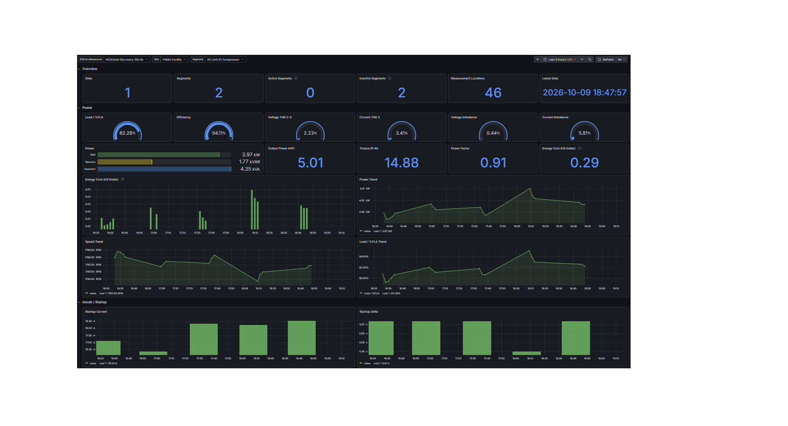

# Architecture

[Back to README](../README.md)

MCEGold Discovery Portal is packaged as a local discovery and dashboard appliance for MCEGold Data Services workflows.

## High-Level Flow

```text
MCEGold Data Services
        |
        v
MCEGold Data Services Connector CLI
        |
        v
Portal / Publication Collector
        |
        v
SQLite discovery database
        |
        v
Grafana
```

## Component Responsibilities

| Component | Responsibility |
| --- | --- |
| MCEGold Data Services | External source of discovery and publication data |
| Connector CLI | Local command-line bridge used by Portal and Publication Collector |
| Discovery Portal | User-facing configuration and guided top-down discovery workflow |
| Publication Collector | Background publication processor for incoming measurement data |
| SQLite | Shared local persistence for configuration, discovered entities, runtime status, and measurements |
| Grafana | Dashboard view over the local SQLite data |

## Default Deployment

The default single-image deployment contains:

- MCEGold Discovery Portal
- MCEGold Discovery Publication Collector
- bundled MCEGold Data Services Connector CLI
- SQLite discovery database
- Grafana

The user does not need to install the Connector CLI separately when using this deployment.

## Data Persistence

The default persistent paths are:

| Path | Purpose |
| --- | --- |
| `/config` | local configuration files |
| `/data` | SQLite database and Grafana data |

The Portal initializes the SQLite discovery database when needed. The Publication Collector reads settings and writes runtime data to the same database. Grafana reads from the local SQLite database through its configured SQLite datasource.

## Reference Data

The Portal includes `docs/CCOM Reference Data.xml` and uses it to seed local reference dimensions for type labels and reporting metadata. This seed data is part of the public release assets and remains subject to the notices in [Third-Party Notices](../THIRD-PARTY-NOTICES.md).

## Grafana Dashboard



The bundled Grafana dashboard provides an operational view of the SQLite discovery data. It is a dashboard surface, not the source of record; the local SQLite database is the shared persistence layer for the deployment.
